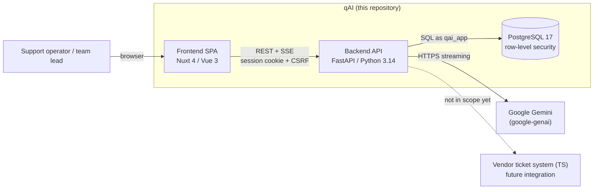
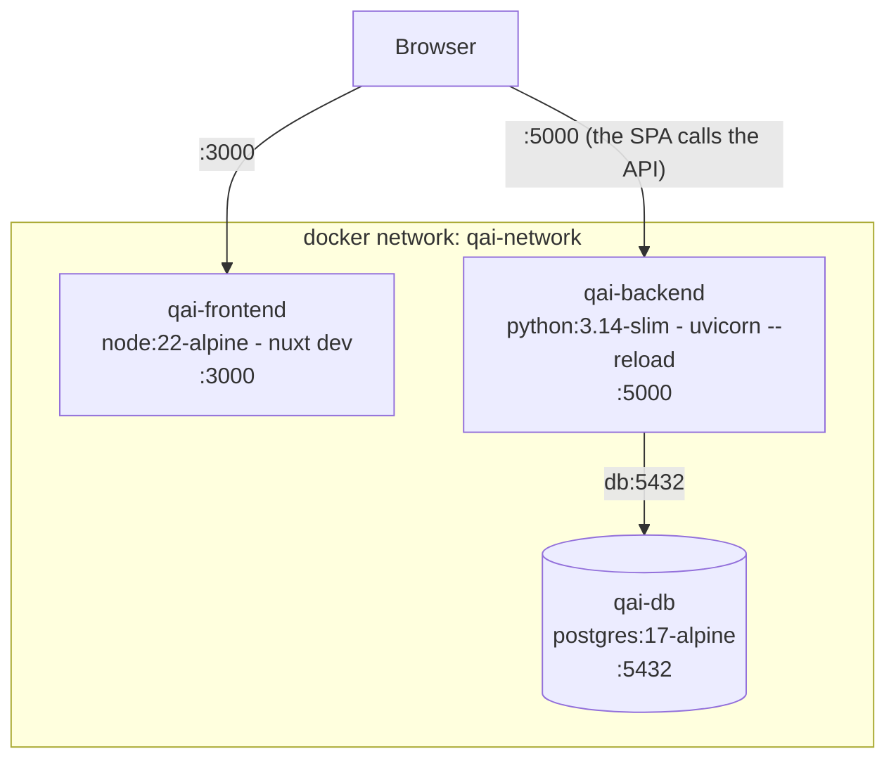
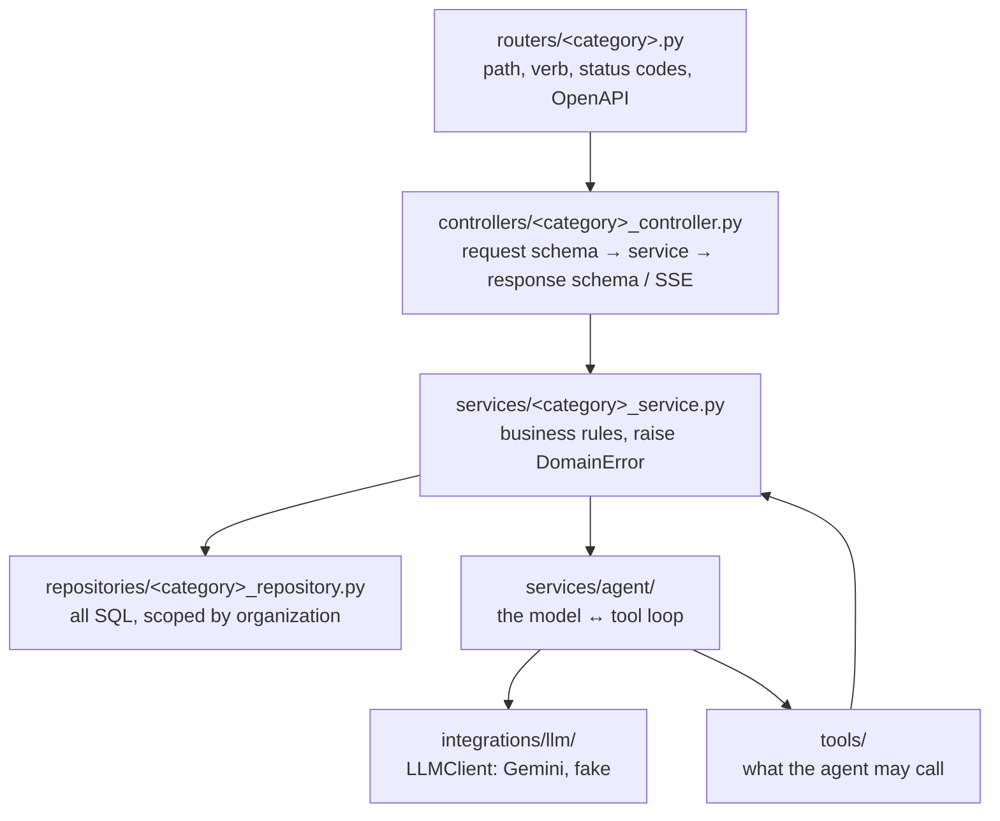
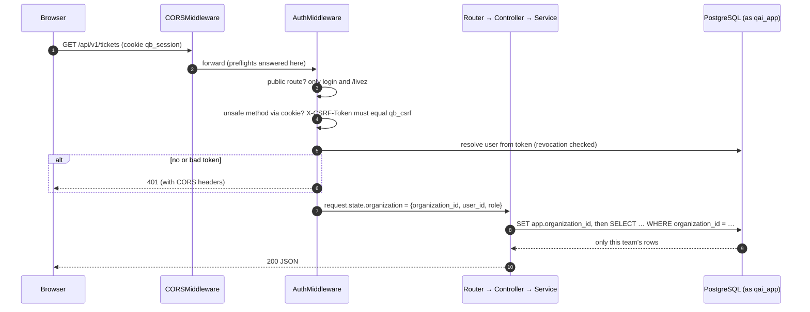
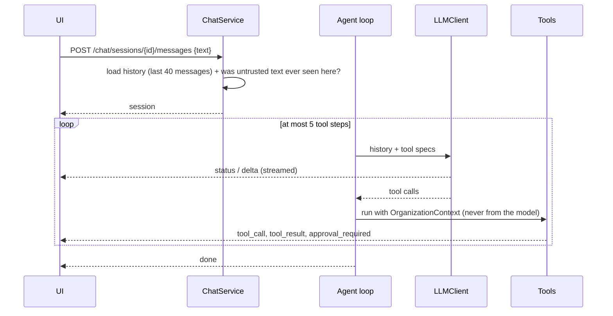
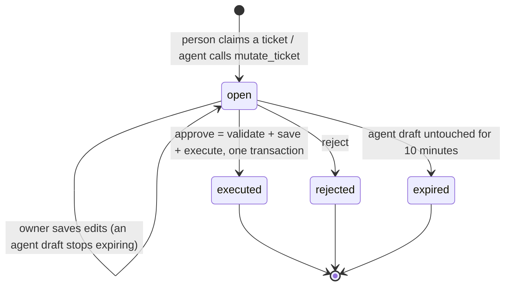
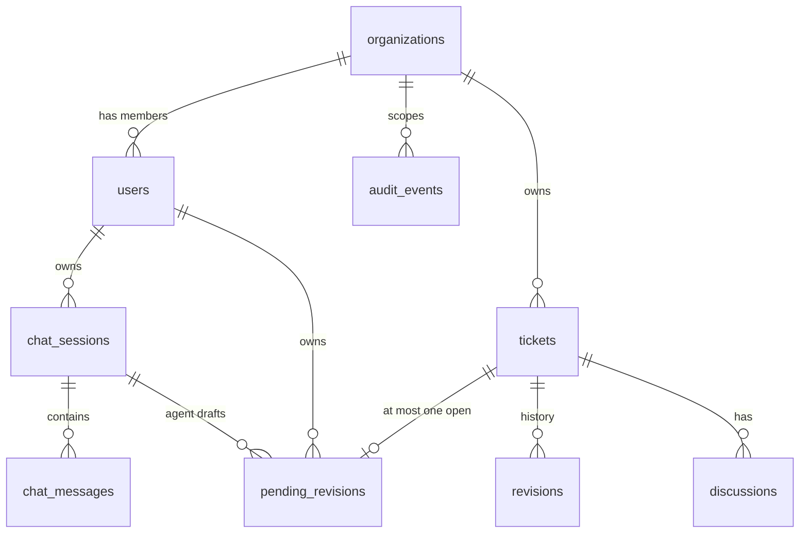
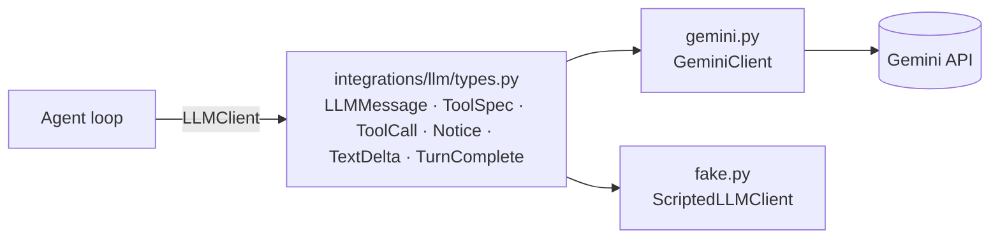

# qAI - Architecture & Operations
By Simeon Marlokov | 26/10/2026

    This document explains how qAI is built and how we run it - the services, the agent, how teams are
    kept apart, how a change gets approved, and what to do when something breaks. The product context
    is in ExerciseScenario.md, the plan and every decision in docs/roadmap/ROADMAP.md, and the short
    version for reviewers in README.md. When the code and this document disagree, the code wins -
    please fix the document.

---
## 1. In short

qAI is an AI assistant for our two support teams - Excellence and Quantum Workflow. It helps operators find and prepare ticket data faster (our target is **≤ 10 minutes per ticket**, down from ~39), it **never shows one team the other team's tickets**, and it **never changes a ticket without a person approving it**.

Right now the system is as follows:

| Capability | State |
|---|---|
| Three services under Docker Compose - SPA, API, PostgreSQL. Migrations and seed run on startup | ✅ |
| Real login - JWT in an httpOnly cookie, CSRF protection, logout with token revocation, rate limits | ✅ |
| Team isolation - organization from the session, repository filters, PostgreSQL row-level security with a non-owner app role | ✅ |
| Ticket domain - tickets, revisions, discussions, soft delete | ✅ |
| Agent - streaming chat, `search_tickets`, `mutate_ticket`, bounded tool loop, persistent chat history | ✅ |
| Approval gate - **Pending Revisions** (drafts) for people and the agent, tainted drafts need a team lead, expiry. A blocking approval modal in the chat | ✅ |
| Audit trail - append-only events, team leads see their whole team | ✅ |
| LLM - Gemini behind an interface, with retries, model fallback, timeouts and daily-quota handling. Gemini by default, a scripted fake model for CI and E2E | ✅ |
| Tests - unit, API (real PostgreSQL), security, migrations, adversarial scenarios, Playwright E2E. CI on every change to a service, live evals nightly | ✅ |
| Metrics, error tracking, production deployment | ⏳ see §17 |

The idea behind everything below - **every safety rule lives in code the model can't influence.** Team scoping is in the repositories and the database, approval is a server-side state machine, authentication runs before routing. A system prompt is never a security control.

---
## 2. Why it is built this way

From the scenario: ticket volume is growing fast, over 75% of it goes to Quantum Workflow, and the vendor system we use today has a history of showing one team the other team's tickets. We want AI help, but every key decision stays with people.

That gives us these drivers, in order:

| # | Driver | What it means for the architecture |
|---|---|---|
| D1 | **Team isolation is non-negotiable** | The organization comes from the session, never from a body or from model output. It is enforced in the repositories **and** in PostgreSQL itself (row-level security). |
| D2 | **A person approves every change** | The agent can only draft. Executing a draft is a separate request by a person. |
| D3 | **Ticket text is attacker-controlled** | Tools are scoped and validated on the server, whatever the model asks for. Drafts raised from untrusted text need a second person. |
| D4 | **It has to feel fast** | Everything streams. The UI always shows what's happening - "model busy, switching…" - nothing sits silent. |
| D5 | **Vendor neutrality and availability** | The model sits behind an interface. Overload, rate limits and quota are normal operating conditions, not crashes. |
| D6 | **Small team, fast iteration** | Strict, repeatable layers, so a new feature is fill-in-the-blanks. One command runs everything. |

---
## 3. The system



- The **browser only talks to our backend.** The SPA is static (`ssr: false`) and holds no secrets - the session is an httpOnly cookie it can't read.
- **Only the backend talks to Gemini.** The API key never reaches the browser.
- **Tickets live in our database.** Syncing with the vendor system is a later epic (ROADMAP D-23).

---
## 4. Runtime



| Service | Image | Port (override) | Notes |
|---|---|---|---|
| `db` | `postgres:17-alpine` | `5432` (`POSTGRES_EXPOSED_PORT`) | Health check `pg_isready` every 5 s. Data in the `db-data` volume. |
| `backend` | built from `services/backend/Dockerfile` | `5000` (`BACKEND_PORT`) | Starts after `db` is healthy and runs `alembic upgrade head` → `python -m src.seed` → `uvicorn --reload`. The source folder is bind-mounted. |
| `frontend` | `dev` target of `services/frontend/Dockerfile` | `3000` (`FRONTEND_PORT`) | Bind-mounted with hot reload. Polling file watcher, because Docker Desktop doesn't forward file events. |

Two things to remember:
- The SPA runs in the browser, so `NUXT_PUBLIC_API_BASE` must be a URL **the browser** can reach (`http://localhost:5000`), not `http://backend:5000`.
- The browser and the API are on different origins, so the frontend origin must be in `CORS_ORIGINS`.

### 4.1 Technology stack

| Layer | Technology | Version |
|---|---|---|
| Backend | Python, FastAPI, Uvicorn | 3.14, 0.162.0, 0.54.0 |
| Validation, settings | Pydantic, pydantic-settings | 2.14.1, 2.16.1 |
| Database access | SQLAlchemy (async), asyncpg, Alembic | 2.1.6, 0.32.0, 1.17.2 |
| Auth | PyJWT, bcrypt | 2.15.1, 5.0.0 |
| LLM | google-genai | 2.33.0 |
| Database | PostgreSQL | 17 |
| Backend tests | pytest, pytest-asyncio, testcontainers, ruff | 8.4.2, 1.2.0, 4.13.2, 0.14.2 |
| Frontend | Nuxt, Vue, Pinia | 4.6.2, 3.5.44, 4.1.0 |
| UI | shadcn-nuxt on reka-ui, Tailwind CSS | 2.8.2, 2.11.0, 4.3.3 |
| Frontend tests | Vitest, Playwright, MSW | 5.0.5, 1.64.1, 3.0.3 |

---
## 5. Repository layout

```
.
├── README.md                    the short version, for reviewers
├── ARCHITECTURE.md              this document
├── ExerciseScenario.md          product context and the domain data model
├── docs/roadmap/                roadmap, contracts, decisions, BE/FE backlogs
├── docker-compose.yml           db + backend + frontend
├── .env.example                 every setting, with comments
├── .github/workflows/           backend, frontend, evals-nightly
└── services/
    ├── backend/
    │   ├── alembic/             migrations 0001-0009 (incl. RLS and the app role)
    │   ├── evals/               adversarial scenarios, gates, runner
    │   ├── src/                 the API (§6)
    │   └── tests/               unit, api, security, migrations, seed, evals
    └── frontend/
        ├── app/                 the SPA (§12)
        ├── e2e/                 Playwright, incl. adversarial UI tests
        └── mocks/               MSW handlers and fixtures
```

---
## 6. Backend

### 6.1 Layers

Each layer has one job and only calls the layer below it. Inside a layer, code is split by category - auth, tickets, pending revisions, chat, audit, health, llm.



| Folder | Job | Must not |
|---|---|---|
| `routers/` | Declare endpoints and delegate | Contain logic or touch the database |
| `controllers/` | Translate between the wire and the domain, build streams | Contain business rules |
| `services/` | Business rules and orchestration. Raise `NotFoundError`, `ConflictError`, `ForbiddenError`, `UnauthorizedError`, `RateLimitError`, `ServiceUnavailableError` | Import FastAPI |
| `repositories/` | Queries and persistence. Team data goes through `OrganizationScopedRepository` | Know about HTTP |
| `tools/` | The two agent tools, their argument models, untrusted-text wrapping | Take the organization from arguments |
| `services/agent/` | The tool loop, history replay, system prompt | Touch the database directly |
| `integrations/llm/` | Vendor adapters behind `LLMClient` | Leak SDK types upward |
| `schemas/<category>/` | `request.py` and `response.py` | Mirror ORM models blindly |
| `dependencies/<category>.py` | Wire session → repository → service → controller per request | Contain logic |
| `middlewares/auth.py` | Authentication for every request | Contain category logic |
| `core/` | Settings, cookies, security, rate limits, revocation, SSE, OpenAPI, output scrubbing | Depend on categories |

### 6.2 One request



- **CORS is the outermost layer on purpose.** A 401 from the auth middleware still carries CORS headers, so the SPA can read it instead of seeing a network error.
- **Errors.** Services raise `DomainError` subclasses with a status code. One handler in `main.py` renders `{"detail": …}` and adds `WWW-Authenticate` on 401 and `Retry-After` on 429. Anything unexpected is logged and answered with a plain 500.

### 6.3 Transactions

Repositories own the commit, and a unique-constraint violation (PostgreSQL `23505`) becomes a 409. The one place where several writes must succeed together - **approving a draft** - happens in a single transaction: lock the draft, check it's not stale, write the revision, update the ticket, close the draft, write the audit events (§8).

Every transaction starts with `set_config('app.organization_id', …, true)` from an `after_begin` listener, so row-level security always knows the team. An empty value means no rows, never all rows.

---
## 7. The agent

### 7.1 One chat turn



- **Bounded loop.** At most `AGENT_MAX_TOOL_ITERATIONS` (5) tool steps per turn. After that the agent explains it stopped and ends normally.
- **History.** The last `AGENT_HISTORY_MAX_MESSAGES` (40) messages are replayed, tool results included in full, Gemini thought signatures included.
- **The model's arguments are validated** against each tool's Pydantic model, with unknown fields rejected. An invalid call becomes a failed `tool_result`, not an exception.
- **Assistant text is scrubbed on the server** - markdown images and links are removed before they reach the browser or the history, so injected text can't exfiltrate data through a rendered URL.

### 7.2 The tools

| Tool | Arguments | What it guarantees |
|---|---|---|
| `search_tickets` | `query`, `status?`, `priority?`, `limit?` (1-20) | Read-only. Scoped to the caller's organization in the repository and by RLS. Returns `contents`, `description` and up to 3 discussions wrapped in `<untrusted_ticket_content>`. Marks the turn as having seen untrusted text. |
| `mutate_ticket` | `id`, `action` (`update` \| `delete`), `fields?` (`status`, `priority`) | **Never writes the ticket.** Creates a Pending Revision, or adds to the caller's own open one. Another team's ticket is "Ticket not found". Someone else's open draft is "being worked on by <name>". |

The tool registry builds the JSON schemas for the model from the same Pydantic models it validates with, so the schema the model sees and the rules we enforce can't drift apart.

### 7.3 Taint

If untrusted ticket text reaches the model in a conversation - in this turn **or any earlier one** - every draft the agent makes in that conversation is **tainted**, and only a team lead can approve it.

It is sticky for the whole conversation on purpose. Tool results are replayed in later turns, and the model's own earlier replies can paraphrase injected text long after the tool result scrolled out of the window. Each stored tool result records `untrusted`. Older rows are recognised by the delimiter.

This was a real bug: taint used to reset every turn, so "look up the VPN ticket" followed by "ok, do it" gave a clean draft. It's fixed, and scenario `08_cross_turn_taint` keeps it fixed.

---
## 8. Pending Revisions - the approval gate

In the scenario, working on a ticket already means opening a "Pending Revision". We use the same thing as the approval gate - **for people and for the agent.**



The rules:

1. **One open draft per ticket.** A partial unique index enforces it. The open draft is the "someone is working on this" claim.
2. **The agent can't approve.** Approve is `POST /pending-revisions/{id}/approve` - a separate, authenticated request by a person.
3. **Who approves.** An untainted draft - only its owner. A tainted draft - **only a team lead** of the same organization (the owner gets 403 but can still reject it).
4. **What runs is what was saved.** Approve can carry final edits. They are validated, saved and executed together. Nothing the model sends later can change a draft it doesn't own.
5. **Stale check.** If the ticket got a new revision since the draft was saved, approve returns 409 and the draft stays open. Saving it again rebases it.
6. **Field rules.** The agent can set `status` and `priority`. A person can also edit `title` and `contents`. `description` is system-managed (the AI summary). Unknown fields are a 422.
7. **Expiry.** Agent drafts expire after 10 minutes unless a person saves them. People's drafts don't expire. Expiry is applied when drafts are read or written, and the chat gets a note "Pending revision … was expired by system".
8. **Delete is soft.** `date_deleted` is set. Restoring is an admin database operation - no API, no tool.
9. **Everything is audited** - created, saved, approved, rejected, expired, and the resulting `ticket_mutated` with the revision id.

After a decision, a system note is added to the chat history, so the agent knows the outcome in its next turn.

**In the UI.** When a chat turn leaves an open draft, a blocking **approval modal** opens as soon as the stream finishes (`components/chat/ApprovalModal.vue`, `composables/useApprovalModal.ts`). It always fetches the draft fresh, shows the change and an expiry countdown, and hosts the same editor as the Drafts page - Save, Approve, Reject. Escape and a click outside don't close it. The only other way out is "Decide later" - or "Leave for team lead" on a tainted draft, where an operator gets no Approve at all. That keeps the draft open and leaves a reminder bar with Reopen. The modal is the UI - the gate is still the server: closing it never executes anything.

The countdown uses only server time for the window (`expires_at - server_time`) and the browser clock only for elapsed time (`utils/draftExpiry.ts`), so a skewed client clock doesn't change it.

---
## 9. Data

### 9.1 Tables

The domain model is the one in ExerciseScenario.md, with the agreed additions (ROADMAP §4).



| Table | What it holds |
|---|---|
| `organizations` | The teams - Excellence, Quantum Workflow |
| `users` | One organization per user, `role` = `operator` or `team_lead`, bcrypt password, case-insensitive unique email |
| `tickets` | `status` open/blocked/closed, `priority` lowest…critical, `title`, `description` (AI summary), `contents` (client Markdown - untrusted), `submitted_by`, `date_deleted` |
| `revisions` | Immutable history - `initial_contents` and `changed_contents` snapshots of title, contents, status, priority |
| `pending_revisions` | The drafts - action, status, `changed_contents`, `previous_revision_id`, `tainted`, `origin` (human/agent), `session_id`, `expires_at`, `decided_by`, `result` |
| `discussions` | Staff comments per ticket. Read-only for the agent, treated as untrusted |
| `chat_sessions`, `chat_messages` | Conversations, private to their owner. Messages store text, tool calls, tool results and the `untrusted` flag |
| `audit_events` | Append-only (the app role can only INSERT and SELECT) |
| `revoked_tokens` | Token ids from logout, purged every night at 02:00 UTC |

Enums are stored as small integers and exposed by name. The API returns timestamps as unix seconds.

### 9.2 Row-level security

This is the part I care about most, so in detail:

- The API connects as **`qai_app`** - not a superuser, not the table owner, `NOBYPASSRLS`. Migrations run as the owner.
- Every team table - `organizations`, `users`, `tickets`, `revisions`, `discussions`, `pending_revisions`, `chat_sessions`, `chat_messages`, `audit_events` - has **`FORCE ROW LEVEL SECURITY`** and a policy on `app.organization_id`, for reads and writes.
- Login has to find a user before we know their organization, so it goes through two narrow `SECURITY DEFINER` functions - `auth_find_user(email)` and `auth_get_user(id)` - instead of opening the `users` table.

So a missing `WHERE` in a repository returns nothing from the other team. It fails closed.

### 9.3 Migrations and seed

Alembic, `0001` → `0009`: baseline, organizations, the app role and RLS, tickets/revisions/discussions, dropping the old placeholder `items`, chat, pending revisions, audit, revoked tokens. Every new team table calls `enable_organization_rls`.

`python -m src.seed` is idempotent and loads `src/seed/fixtures/qai_seed.json`: both teams, 13 staff, about 130 tickets sampled from six months of help-desk volume, their revisions, internal notes, ten open human drafts, and eight adversarial tickets with prompt-injection payloads (`docs/seed/SEED_SCENARIO.md` describes the world; `build_qai_seed.py` generates the file deterministically). Tickets are inserted in file order, so on an empty database every ticket gets the id the fixture calls `expected_id` - ticket #1 is the open Excellence "billing" ticket the fake model's script drafts on. `--reset` wipes the data first. There is no HTTP reset route, and the seed refuses to write when `APP_ENV=production`.

---
## 10. Security

### 10.1 Authentication

| Aspect | How |
|---|---|
| Login | `POST /api/v1/auth/login` - email + password. Unknown emails still run a bcrypt check against a dummy hash, so timing doesn't reveal which accounts exist. |
| Session | JWT (HS256, `sub`, `organization_id`, `role`, `jti`, 60 min) in the **httpOnly `qb_session` cookie**, `SameSite=Lax`, `Secure` outside local. |
| CSRF | Double-submit - the readable `qb_csrf` cookie must be echoed in `X-CSRF-Token` on POST/PUT/PATCH/DELETE when the cookie authenticates the request. |
| API clients | `Authorization: Bearer` still works (Swagger, evals). The login body returns the token while `AUTH_RETURN_TOKEN_IN_BODY=true`. |
| Logout | `POST /auth/logout` revokes the token id in `revoked_tokens` and clears the cookies. |
| Token check | The middleware decodes the token - a missing claim, an unknown role or an empty `jti` makes it invalid - then checks revocation, loads the user and verifies the token's organization still matches the user's. |
| Rate limits | Login - 10 per 15 min per IP+email, 50 per IP. Chat send and approve - 20 per minute per user, 200 per organization. 429 with `Retry-After`. |

### 10.2 Authorization - default deny

- **Every request is authenticated** by `middlewares/auth.py`, before routing. The only exceptions are CORS preflights, the API docs, `GET /livez` and `PUBLIC_API_ROUTES` - which holds just `POST /auth/login`.
- A new route is protected automatically. Making one public is a one-line, reviewed change in one place. Swagger shows the same rule - a lock on everything except login.
- The middleware puts an **`OrganizationContext`** (organization id, user id, role) on the request. Every team-scoped repository and every tool takes it from there - there is no API or tool argument for the organization.
- **Another team's resource is a 404, never a 403**, so we don't confirm it exists.

### 10.3 Untrusted content

| Where it comes from | What we do |
|---|---|
| Ticket `contents`, `description`, discussions | Wrapped in `<untrusted_ticket_content>` before the model sees them. The system prompt says it's data. Helpful, but **not a control**. |
| Anything the model writes | Markdown images and links removed on the server. |
| Anything shown in the UI | Rendered as plain text (`UntrustedText`). `v-html` is a lint error. |
| A draft influenced by it | Tainted - needs a team lead (§7.3). |

### 10.4 Threat model

| Threat | Control | Tested by |
|---|---|---|
| Reading another team's tickets | Organization from the session, repository filter, RLS with a non-owner role | `01_cross_tenant_read`, `tests/security/test_rls.py` |
| Changing another team's ticket | Same, plus "not found" from `mutate_ticket` | `02_cross_tenant_mutate` |
| Injection → destructive action | The agent can only draft. Tainted drafts need a lead | `03_injection_to_mutation`, `08_cross_turn_taint` |
| Injection → data exfiltration | Scoped tools, server-side scrubbing, inert rendering | `04_injection_exfiltration`, E2E `tenant-and-content` |
| Bypassing approval | Approval is a separate request with owner/lead rules and a stale check | `05_draft_integrity`, E2E `approval-bypass`, `decision-integrity` |
| Stale or forgotten agent drafts | 10-minute expiry for agent drafts | `06_approval_expiry` |
| Field smuggling (`organization_id`, `contents` …) | Strict argument models, 422 | `07_field_smuggling`, `tests/security/test_no_organization_inputs.py` |
| Session theft / CSRF | httpOnly cookie, double-submit CSRF, revocation on logout | `tests/api/test_hardening.py` |
| Credential stuffing | Rate limits, constant-time login | `tests/unit/test_rate_limit.py`, `tests/api/test_auth_api.py` |

### 10.5 Secrets

`JWT_SECRET_KEY`, `POSTGRES_PASSWORD`, `POSTGRES_APP_PASSWORD` and `GEMINI_API_KEY` live in `.env`, which is gitignored. `.env.example` only has placeholders. The Gemini key never leaves the backend. Rotating the JWT secret signs everyone out.

---
## 11. LLM integration

### 11.1 The boundary



- The agent only knows `LLMClient`. Gemini is one adapter. Another vendor would be one more file.
- **Gemini** is the Compose default (`LLM_PROVIDER=gemini`). **The fake model** replays YAML scripts - text, notices, tool calls, delays, errors - keyed by the user's message. CI and local end-to-end tests set `LLM_PROVIDER=fake` so those runs stay deterministic. **The tools still run for real** - only the model's decisions are scripted. The backend refuses to start with the fake model when `APP_ENV=production`.
- `get_llm_client()` returns one client per process. Without a key (and not fake), chat answers **503 before streaming starts**.

### 11.2 Resilience

Hosted models get overloaded, so this is treated as normal:

| Situation | Detection | What happens | The user sees |
|---|---|---|---|
| Stream starts | - | A status event goes out immediately | "Waiting for gemini-3.8-flash…" |
| 503, or a per-minute 429 | HTTP status | Retry with backoff, then the next model in `GEMINI_FALLBACK_MODELS` | "… is busy, retrying…" / "switching to …" |
| Model hangs | No first chunk in `GEMINI_FIRST_CHUNK_TIMEOUT_SECONDS` (20 s) | The attempt is dropped and its stream closed, next model | "… is busy (no response in time), switching to …" |
| **Daily quota** used up | 429 whose `QuotaFailure` has a `quotaId` with `PerDay` | No retries. The model is skipped until the reset. If all are out, fail immediately without calling Google | "The daily Gemini quota is used up … resets in about N h" |
| Fallback worked | - | That model stays preferred for 5 minutes | - |
| Long answer | - | Only `GEMINI_REQUEST_TIMEOUT_SECONDS` (180 s) applies once streaming. The SDK also sends it to Google as the server deadline. | Continuous text |
| Failure mid-stream | API error or timeout while reading | An `error` event | Partial text + error |
| User aborts | Client disconnects | The provider stream is cancelled | - |

Why two timeouts? The SDK sends its one timeout value to Google as the deadline for the **whole** generation. One short value would cut long answers. So "time to first chunk" is our overload detector, and "whole request" is generous.

### 11.3 Streaming protocol

Chat: `POST /api/v1/chat/sessions/{id}/messages` with `{"text": "…"}` answers `text/event-stream`, one `data: <json>` frame per event:

| Event | Fields | When |
|---|---|---|
| `session` | `session_id` | First |
| `status` | `message` | Progress - lasts until the next event |
| `delta` | `text` | Assistant text |
| `tool_call` | `call_id`, `name`, `args` | The model called a tool |
| `tool_result` | `call_id`, `ok`, `result` or `error` | The tool ran or was rejected |
| `approval_required` | `call_id`, `pending_revision` | `mutate_ticket` created or updated a draft. The turn can continue. |
| `done` | `message_id`, `model` | End - success |
| `error` | `message`, `code` (`llm_unavailable` / `quota_exhausted` / `internal`) | End - failure |

`session → (status | delta | tool_call | tool_result | approval_required)* → done | error`. 401, 404, 422, 429 and 503 come back as normal HTTP errors **before** the stream starts. After the first byte, a failure is an `error` event.

`POST /api/v1/llm/stream` is a dev-only diagnostic with no tools. It's disabled when `APP_ENV=production`.

---
## 12. Frontend

### 12.1 Layers

The same idea as the backend:

```
pages → composables → services → api/endpoints → api/client.ts → FastAPI
              \→ stores (session state only)
```

| Folder | Job |
|---|---|
| `pages/` | `/login`, `/` dashboard (open / blocked / closed counts), `/tickets`, `/chat`, `/chat/[id]`, `/drafts`, `/review` (team leads), `/audit` |
| `composables/` | Page logic - `useChat`, `useApprovalModal`, `useChatSessions`, `useTicketList`, `useTicketDetail`, `useAuth`, `useLoginForm`, `useToast` … |
| `services/` | Call the endpoints and map the API shapes to view models |
| `api/client.ts` | `request` ($fetch) and `stream` (fetch + SSE reader). Cookies, CSRF header, 401 handling, `ApiError` with `Retry-After` |
| `utils/chatStreamReducer.ts`, `utils/draftExpiry.ts` | Pure helpers - the chat event grammar, and the skew-safe expiry countdown. Easy to unit test |
| `stores/auth.ts` | The current user only. The token is never readable by JavaScript |
| `middleware/auth.global.ts` | Every page needs a session unless it declares `public: true` - only `/login` does |
| `components/` | shadcn-vue primitives in `ui/` (incl. an `alert-dialog` that ignores Escape and outside clicks), plus `chat/` (`ApprovalModal`, `ToolCallTrace` …), `drafts/`, `tickets/`, `common/` (`UntrustedText`, `NotFoundState`) |

### 12.2 What the operator sees

- **Chat** streams the answer and shows every tool call as a collapsible trace - name, arguments, result, and the draft state ("Awaiting approval", "Executed" …) with a link to the draft. When the turn leaves an open draft, the **approval modal** opens (§8).
- **Drafts** lists the operator's own drafts and opens a review panel - diff, editor, Save / Approve / Reject.
- **Review** is the team lead's queue of tainted drafts.
- **Tickets** has search, filters and a detail drawer with revisions and discussions.
- A 404 on any detail page - including another team's id - is shown as "doesn't exist". It never mentions teams or permissions.

The SPA can run without the backend - `NUXT_PUBLIC_USE_MOCKS=true` turns on MSW with fixtures for the same API contracts.

---
## 13. Operations

### 13.1 Environments

| Environment | How | State |
|---|---|---|
| Local | `cp .env.example .env && docker compose up --build` - with a `GEMINI_API_KEY`, or `LLM_PROVIDER=fake` | ✅ |
| CI | GitHub Actions - see §15 | ✅ |
| Staging / production | - | ⏳ §13.5 |

### 13.2 Settings (`.env`)

| Setting | Default | What it does |
|---|---|---|
| `APP_ENV` | `local` | `production` refuses the fake model, the seed and `/llm/stream` |
| `API_V1_PREFIX`, `CORS_ORIGINS` | `/api/v1`, localhost:3000 | API prefix and browser origins allowed to call it |
| `JWT_SECRET_KEY`, `JWT_EXPIRE_MINUTES` | -, `60` | Token signing and lifetime |
| `AUTH_RETURN_TOKEN_IN_BODY` | `true` | Also return the token in the login body (for API clients) |
| `TRUSTED_PROXIES` | empty | Peers allowed to set the client IP through `X-Forwarded-For` |
| `RATE_LIMIT_*` | see §10.1 | Login and write limits |
| `LLM_PROVIDER`, `LLM_FAKE_SCRIPT_PATH` | `gemini`, `read_path.yaml` | Which model, and the fake model's script |
| `GEMINI_API_KEY`, `GEMINI_MODEL`, `GEMINI_FALLBACK_MODELS` | -, `gemini-3.8-flash`, `gemini-3.5-flash` | Gemini |
| `GEMINI_FIRST_CHUNK_TIMEOUT_SECONDS`, `GEMINI_REQUEST_TIMEOUT_SECONDS` | `20`, `180` | The two timeouts (§11.2) |
| `GEMINI_MAX_RETRIES`, `GEMINI_TEMPERATURE` | `1`, `0.2` | Retries per model, sampling |
| `AGENT_MAX_TOOL_ITERATIONS`, `AGENT_HISTORY_MAX_MESSAGES` | `5`, `40` | The agent loop bounds |
| `POSTGRES_USER`, `POSTGRES_PASSWORD`, `POSTGRES_DB` | `quickbase`, -, `quickbase` | Owner role - migrations |
| `POSTGRES_APP_USER`, `POSTGRES_APP_PASSWORD` | `qai_app`, - | The API's role - RLS applies to it |
| `SEED_USER_PASSWORD` | `admin123` | Dev logins |
| `BACKEND_PORT`, `FRONTEND_PORT`, `POSTGRES_EXPOSED_PORT`, `NUXT_PUBLIC_API_BASE` | `5000`, `3000`, `5432`, `http://localhost:5000` | Ports and the browser-reachable API URL |

After changing `.env`, recreate the container - `docker compose up -d --force-recreate backend` - a plain restart doesn't reload it.

### 13.3 Runbooks

| Situation | What to do |
|---|---|
| **Start everything** | `cp .env.example .env`, put a `GEMINI_API_KEY` in it (or set `LLM_PROVIDER=fake`), `docker compose up --build`, open http://localhost:3000, sign in as `op1@excellence.qai.local` / `admin123`. |
| **Run the E2E tests locally** | The stack must run on the fake model: set `LLM_PROVIDER=fake` in `.env`, `docker compose up -d --force-recreate backend`, then `npm run e2e` in `services/frontend`. CI does the same. |
| **Reset the data** | `docker compose exec backend python -m src.seed --reset`. To also wipe the schema: `docker compose down -v && docker compose up --build` - this destroys the volume. |
| **"port is already allocated"** | Another stack holds the port - `docker ps` shows which. Stop it, or override the port (e.g. `FRONTEND_PORT=3001`) **and** add the new origin to `CORS_ORIGINS`. |
| **The UI says "Cannot reach the server"** | Check the backend is up (`docker compose logs backend`), `NUXT_PUBLIC_API_BASE` is reachable from the browser, and the origin is in `CORS_ORIGINS`. |
| **Chat replies with an echo instead of an answer** | You're on the fake model and the prompt isn't in its script. Use a scripted prompt (README) or switch to Gemini. |
| **Chat answers 503 "not configured"** | `LLM_PROVIDER=gemini` without a key. Set `GEMINI_API_KEY` and recreate the backend. |
| **"daily Gemini quota is used up"** | Expected on the free tier (20 requests per model per day). Wait for the reset, add a model with quota to `GEMINI_FALLBACK_MODELS`, or use a paid key. A restart forgets the state - each model costs one wasted request before it's skipped again. |
| **Frequent "model busy, switching…"** | Gemini overload. Put the more available model first, or raise the first-chunk timeout if the model is just slow to start. |
| **429 on chat or approve** | The write rate limit (20/min per user, 200/min per team). Wait for `Retry-After`. |
| **"CSRF check failed"** | The `qb_csrf` cookie is missing or wasn't echoed - usually a stale tab. Sign in again. |
| **Backend stopped after a code change** | The reloader can exit if an imported module was deleted mid-edit. `docker compose restart backend` and check the logs. |
| **Rotate the JWT secret / Gemini key** | Update `.env`, recreate the backend. A new JWT secret signs everyone out. Revoke the old Gemini key in AI Studio. |
| **Check health** | `GET /livez` (public, no data) for liveness. `GET /health` (authenticated) also probes the database. |

### 13.4 Observability

Today - loguru logs to stdout, the uvicorn access log, PostgreSQL logs (constraint violations included), the audit trail in the database, `/livez` and `/health`.

Missing - structured JSON logs with a request id, metrics (latency, LLM time to first token, fallbacks, quota events, tokens), error tracking (Sentry). Planned in M5.

### 13.5 Path to production

| Area | Today | Plan |
|---|---|---|
| Backend | `uvicorn --reload`, source mounted | Image without the mount, several workers behind a reverse proxy |
| Frontend | `nuxt dev` | The `prod` Docker target - `nuxt generate` served by nginx |
| One origin | SPA :3000 → API :5000 (needs CORS) | A proxy serving `/` and `/api` - no CORS, simpler cookies |
| SSE through proxies | Direct | Proxy buffering off (`X-Accel-Buffering: no` is already sent), read timeout ≥ 180 s |
| Database | Container | Managed PostgreSQL, migrations as a release step, backups |
| Secrets | `.env` | A secret manager |
| Rate limits, quota state | In memory, per process | Redis once there is more than one instance |
| LLM | Free tier | Paid tier with a budget alert, token accounting per team |

---
## 14. API

All under `/api/v1` unless noted. Everything except login and `/livez` needs a session.

| Method | Path | What |
|---|---|---|
| POST | `/auth/login` | **Public.** Sets the cookies, returns the token while `AUTH_RETURN_TOKEN_IN_BODY=true` |
| POST | `/auth/logout` | Revokes the token, clears the cookies |
| GET | `/auth/me` | Current user, role and organization |
| GET | `/tickets` | Search, filter (`status`, `priority`), sort, paginate |
| GET | `/tickets/{id}` | Ticket with revisions, discussions and the open draft. 404 for another team |
| POST | `/tickets/{id}/pending-revisions` | A person claims the ticket - opens a draft. 409 if someone else has one |
| GET | `/pending-revisions` | Own drafts (`status`, `ticket_id`, `session_id`), or `scope=lead_queue` for team leads |
| GET | `/pending-revisions/{id}` | One draft |
| PUT | `/pending-revisions/{id}` | Save edits (owner) |
| POST | `/pending-revisions/{id}/approve` | Validate + save + execute. 403 / 409 / 410 / 422 |
| POST | `/pending-revisions/{id}/reject` | Reject |
| POST | `/chat/sessions` | New conversation |
| GET | `/chat/sessions` | Own conversations |
| GET | `/chat/sessions/{id}` | A conversation with its messages and tool traces |
| POST | `/chat/sessions/{id}/messages` | **SSE** - one agent turn (§11.3) |
| GET | `/audit` | Own events, or the whole team for team leads |
| POST | `/llm/stream` | Dev-only diagnostic stream, no tools |
| GET | `/livez` (no prefix) | **Public** liveness |
| GET | `/health` (no prefix) | Database probe |
| GET | `/docs`, `/openapi.json` | Swagger |

---
## 15. Quality

| Suite | What it covers | How to run |
|---|---|---|
| Backend unit | Agent loop, tool registry, Gemini tool mapping, fake provider, rate limits, security helpers, revocation purge, draft rules | `docker compose exec backend pytest -m unit` |
| Backend API | Every endpoint against a real PostgreSQL (testcontainers) - auth, tickets, drafts, chat, hardening, RLS, migrations, seed, the scripted adversarial suite | `pytest -m api` - needs Docker access (see README) |
| Adversarial evals | 8 scenarios, one per category, scripted and live (README has the table) | `python -m evals.run [--live --trials 3]` |
| Frontend unit | Services, composables, the stream reducer, the SSE reader, components, sanitizing | `npm test` |
| Frontend E2E | Login, tenancy, tickets, chat, the approval modal (opens after the turn, blocks until clicked, only Approve writes; tainted → no Approve for an operator), drafts, hardening, accessibility, adversarial UI (approval bypass, decision integrity, cross-team content) | `npm run e2e` against the running stack, on the fake model |

**CI** (`.github/workflows/`):
- **backend** - ruff lint and format, `pytest -m "unit or api"`, the scripted eval suite, a Docker build. On pushes and pull requests that touch the backend.
- **frontend** - typecheck, unit tests with coverage, `nuxt generate`, then Playwright against `docker compose up`. On pushes and pull requests that touch the frontend.
- **evals-nightly** - the live suite against Gemini, 3 trials, every night at 02:00.

The adversarial gates are deterministic checks on the transcript and the database, not an LLM judge. Scripted variants test **our controls** - the fake model does exactly the bad thing. Live variants test that the real model doesn't get us there by accident.

---
## 16. Decisions

The full list, with alternatives, is in ROADMAP §5.4-5.5. The ones that shape the architecture:

| # | Decision | Why | Instead of |
|---|---|---|---|
| ADR-01 | Strict layers on both sides, split by category | Predictable place for everything, same model front and back | Feature folders |
| ADR-02 | Authentication in middleware, default deny, explicit allowlist | One choke point, new routes safe by default | Per-router dependencies, a `@public` decorator (needs FastAPI internals) |
| ADR-03 | Static SPA (`ssr: false`) | Nothing to run or secure server-side for the UI | SSR |
| ADR-04 | JWT in an httpOnly cookie + double-submit CSRF, Bearer kept for API clients | The browser never holds the token | A JS-readable cookie (what we started with) |
| ADR-05 | **RLS with a non-owner app role**, on top of repository filters | Isolation enforced by the database - a bug fails closed | Filters in Python only |
| ADR-06 | Alembic migrations, the app role and policies included | Schema history, reproducible databases | Init SQL (what we started with) |
| ADR-07 | **Pending Revisions are the approval gate for everyone**, with a blocking modal in the chat as the UI | One concept for people and the agent, survives reloads, can't be bypassed by the client | A popup that only blocks in the browser |
| ADR-08 | Approve = validate + save + execute in one transaction, with a stale check | What runs is exactly what was saved | Separate save and execute requests |
| ADR-09 | **Sticky taint per conversation** | Replayed history and paraphrases carry injected text across turns | Per-turn taint (the bug we fixed) |
| ADR-10 | LLM behind `LLMClient` - Gemini by default, a scripted fake for CI and E2E | Vendor neutrality, deterministic tests that don't spend quota | Calling the SDK from services |
| ADR-11 | SSE over POST, fetch-based reader on the client | One-way streams fit SSE, POST carries the body and cookies | WebSockets, `EventSource` (GET only) |
| ADR-12 | Separate first-chunk (20 s) and request (180 s) timeouts | The SDK's timeout is also Google's server deadline | One timeout |
| ADR-13 | Daily-quota 429s skip the model until reset, in memory | No pointless retries, an honest message | Redis-backed state (later) |
| ADR-14 | `BaseHTTPMiddleware` for auth | Simple, verified to stream without buffering and to propagate disconnects | Pure ASGI middleware |
| ADR-15 | shadcn-vue on reka-ui | The components live in our repo | A full component framework |

---
## 17. Risks and technical debt

| # | Item | Impact | Mitigation |
|---|---|---|---|
| R1 | **The default stack needs a Gemini key** - without one the chat answers 503, and the free tier runs out quickly | Medium (first-run experience) | `LLM_PROVIDER=fake` for a key-less demo. Consider falling back to the fake model when no key is set, outside production |
| R2 | **A fresh clone needs `cp .env.example .env`** - Compose requires `.env` | Low | Make `env_file` optional with safe defaults |
| R3 | ~~Injection payloads are seeded in `contents`, not in `description`~~ Resolved: the seed carries a poisoned-summary ticket (payload in `description` and `contents`) and an instruction-in-title ticket | - | - |
| R4 | **Taint is per conversation** - strict, so leads get many drafts | Medium (workload) | Track taint per source ticket |
| R5 | Ticket **titles** aren't wrapped as untrusted | Medium | Wrap titles like contents |
| R6 | Free-tier Gemini - 20 requests per model per day | High for evals and pilots | Paid tier, budgets, per-team limits |
| R7 | Rate limits and quota state are in memory, per process | Low now | Redis when scaled out |
| R8 | No metrics or error tracking | Medium | M5 - JSON logs with request id, metrics, Sentry |
| R9 | `evals.run` reseeds whatever database `.env` points at | Low (dev only) | Run it against a dedicated test database |
| R10 | Some API tests assume no LLM is configured in the environment | Low (CI is clean) | Pin `LLM_PROVIDER` in the test fixtures |
| R11 | Agent-draft expiry is lazy (on read/write), not swept | Low | A periodic sweep if timely notes matter |
| R12 | The login body still returns the token (for API clients) | Low | Turn off `AUTH_RETURN_TOKEN_IN_BODY` behind a single-origin proxy |

---
## 18. Glossary

| Term | Meaning |
|---|---|
| **Organization** | A support team - Excellence or Quantum Workflow. The isolation boundary for all data. In the exercise this is the "tenant". |
| **Pending Revision** | A draft change to a ticket. Nothing happens to the ticket until a person approves it. |
| **Tainted** | A draft made by the agent in a conversation that has seen untrusted ticket text. Only a team lead can approve it. |
| **Untrusted content** | Ticket `contents`, `description` and discussions - text that came from clients, or was derived from it. |
| **Fake model** | The scripted `LLMClient` used in CI and the E2E tests (`LLM_PROVIDER=fake`). The tools still run for real. |
| **RLS** | PostgreSQL row-level security - per-row policies enforced by the database. |
| **Default deny** | Every route needs a session unless it's explicitly allowlisted. |
| **First chunk** | The first piece of a streamed model answer. How long it takes is our overload signal. |
| **SSE** | Server-Sent Events - a one-way HTTP stream of `data:` frames. |
