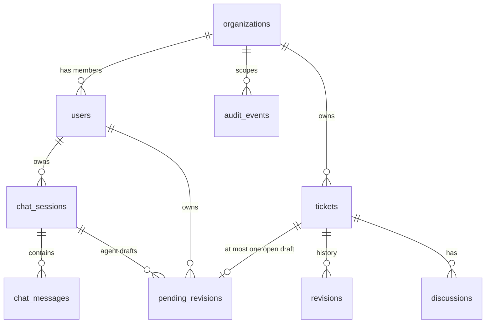
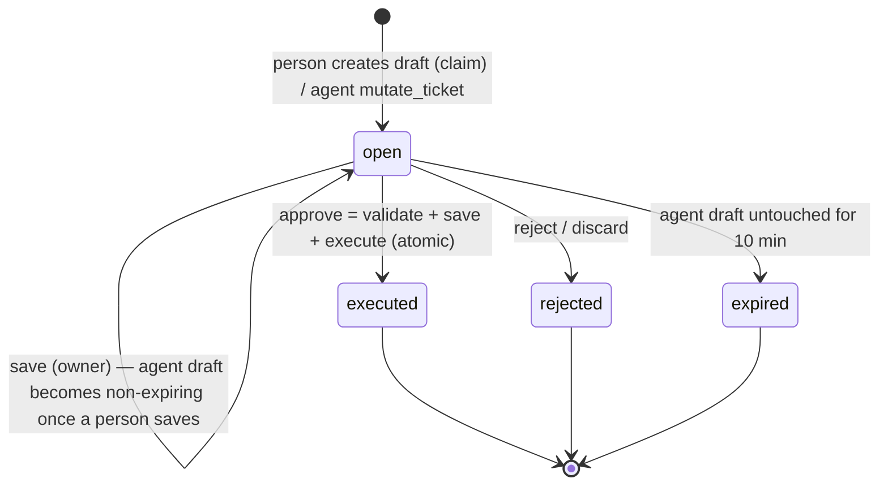

# qAI Product Roadmap & Integration Plan

| | |
|---|---|
| **Owner** | Simeon Marlokov (CTO) |
| **Date** | 25.10.2026 |
| **Status** | **Data model locked** (§4) · contracts **v1.2** (§5). Both backlogs are aligned through their v1.2 addenda. |
| **Inputs** | [ARCHITECTURE.md](../../ARCHITECTURE.md) · [ExerciseScenario.md](../../ExerciseScenario.md) (incl. the domain data model) · [guarded-tool-use-agent-exercise.md](../../guarded-tool-use-agent-exercise.md) |
| **Backlogs** | [BE_TASKS.md](BE_TASKS.md) (`QAI-BE-*`) · [FE_TASKS.md](FE_TASKS.md) (`QAI-FE-*`) |

---

## 1. Product goal

Give the Excellence and Quantum Workflow support teams an AI assistant that:
- **finds and prepares** ticket data fast (KPI: average handling time ≤ 10 min, down from ~39 min);
- **never shows one team another team's tickets**, at any layer;
- **never changes a ticket without a human approving it.** Every change, by a person or by the agent, is prepared as a **Pending Revision** (a draft), and only an explicit Approve executes it. The operator is accountable.

## 2. Release plan

| Milestone | Theme | Outcome (demo-able) | Depends on |
|---|---|---|---|
| **M1 — Team-safe data** | Organizations, tickets, revisions, discussions, migrations, test foundation | Operators sign in to their own team; they see only their team's tickets, revisions and discussions; cross-team access is impossible, and tests prove it. | Foundation (done) |
| **M2 — Agent read path** | Chat sessions, the agent loop, `search_tickets`, streamed tool trace | An operator asks "what's blocked on billing?" and sees a streamed answer plus the tool call and its result. | M1 |
| **M3 — Pending Revisions** | Draft workflow for people and the agent, `mutate_ticket`, review and approval UI, tainted → team lead, audit | The agent drafts a status/priority change; the operator reviews or edits the draft and approves it (a tainted draft goes to the team lead); a Revision is recorded; every step is audited. | M2 |
| **M4 — Adversarial assurance** | Injection seed data, adversarial evaluation suite, rate limits, cookie hardening | Security scenarios pass across repeated runs in CI; the system copes with abuse and outages. | M3 |
| **M5 — Pilot readiness** | Production build, single-origin proxy, paid LLM tier, observability | A Quantum Workflow pilot in staging, with KPI tracking. | M4 |

Exercise scope (single-command run, two tools, approval gate in the UI, adversarial tests, README) is complete at **M3 plus the M4 evaluation suite**.

## 3. Epics

| Epic | Title | Milestone | BE | FE |
|---|---|---|---|---|
| **QAI-E1** | Test & CI foundation | M1 | pytest stack, test DB, fake LLM, CI job | Vitest, Playwright, MSW mocks, CI job |
| **QAI-E2** | Organizations & identity | M1 | Organizations, `users.organization_id` + `role`, JWT claims, organization context, RLS | Organization-aware session, team badge, cache isolation |
| **QAI-E3** | Ticket domain | M1 | Tickets, Revisions, Discussions, Alembic, seed (incl. injection payloads), ticket API | Ticket list and detail (contents, revisions, discussions) |
| **QAI-E4** | Conversational agent | M2 | Chat sessions/messages, agent loop, function calling, `search_tickets`, chat SSE | Chat page, streaming, tool-call trace, session list |
| **QAI-E5** | Pending Revisions (approval gate) | M3 | Draft lifecycle, one open draft per ticket, `mutate_ticket`, save, approve (validate + save + execute), reject, expiry, tainted → lead, stale check | Draft review/edit panel, approve/reject, tainted lead queue, expiry countdown, trace links |
| **QAI-E6** | Audit & transparency | M3 | Append-only audit events + API (team leads see their whole team) | Audit trail view |
| **QAI-E7** | Security hardening & resilience | M4 | Rate limits, httpOnly cookie + CSRF, `/livez`, revocation table, login hardening, error handler | Cookie client, CSRF, 429 UX, error boundary |
| **QAI-E8** | Adversarial evaluation | M4 | Scenario runner, deterministic gates, CI | Playwright adversarial E2E |
| **QAI-E9** | Observability & production | M5 | Logs, metrics, Sentry, prod image, migrations in deploy | Sentry, prod build behind proxy, performance budget |

## 4. Data model (locked 25.10.2026)

The **domain model** is the one in [ExerciseScenario.md → Data Models](../../ExerciseScenario.md). The tables below restate it with the agreed **additions** (marked ➕) and the **qAI platform tables** that the agent needs.



### 4.1 Domain tables

| Table | Columns | Notes |
|---|---|---|
| `organizations` | `organization_id` int identity, `name` varchar(255) | A team = the tenant (Excellence, Quantum Workflow) |
| `users` | `user_id` int identity, `name` varchar(255), `email` varchar(255) (unique, case-insensitive), `password` varchar(255) (**bcrypt hash**), `organization_id` FK, ➕ `role` (`operator` \| `team_lead`) | One organization per user (Q1) |
| `tickets` | `ticket_id` int identity, ➕ `organization_id` FK, `status` StatusEnum, `priority` PriorityEnum, `title` varchar(255), `description` varchar(500), `contents` varchar(2000), `submitted_by` varchar(255), `date_created`, `updated_by` FK users nullable, `date_updated`, ➕ `date_deleted` nullable | `contents` = client-submitted Markdown (never HTML), **untrusted**. `description` = AI-generated summary of the contents and discussions, **system-managed**, derived from untrusted input. |
| `revisions` | `revision_id` uuid v4, `ticket_id` FK, ➕ `organization_id`, `user_id` FK, `initial_contents` JSONB, `changed_contents` JSONB, `date_created` | Immutable history. The `*_contents` columns are an **EditableSnapshot** (§4.3). |
| `pending_revisions` | `id` uuid, `ticket_id` FK, ➕ `organization_id`, `previous_revision_id` FK nullable, `user_id` FK (owner), `changed_contents` JSONB, `date_created`, `date_updated`, ➕ `action` (`update` \| `delete`), ➕ `status` (`open` \| `executed` \| `rejected` \| `expired`), ➕ `tainted` bool, ➕ `expires_at` nullable, ➕ `decided_by` FK nullable, ➕ `decided_at` nullable, ➕ `origin` (`human` \| `agent`), ➕ `session_id` FK nullable, ➕ `result` JSONB nullable | **The approval gate.** A partial unique index ensures one `open` draft per ticket. `origin`, `session_id` and `result` were added beyond the reviewed list: they're needed for expiry, chat linking and the execution outcome. |
| `discussions` | `id` int identity, `ticket_id` FK, ➕ `organization_id`, `user_id` FK, `contents` text | Staff comments, read-only for the agent and **treated as untrusted** (often quotes client text). Ordered by `id`. |

**Enums** are stored as `smallint` with check constraints, and the API uses their names. **StatusEnum:** `1 open` · `2 blocked` · `3 closed`. **PriorityEnum:** `1 lowest` · `2 low` · `3 medium` · `4 high` · `5 critical`.

**Timestamps** are stored as `timestamptz` and exposed by the API as **unix seconds** (integers), per the domain model.

### 4.2 qAI platform tables

| Table | Columns | Notes |
|---|---|---|
| `chat_sessions` | `id` uuid, `organization_id`, `user_id`, `title`, `date_created`, `last_activity_at` | Private to their owner (team leads don't read chats, Q4) |
| `chat_messages` | `id`, `session_id`, `organization_id`, `role` (`user` \| `assistant` \| `tool`), `content` JSONB, `model`, `date_created` | Replayed into the LLM history; kept indefinitely for now (Q6) |
| `audit_events` | `id`, `organization_id`, `actor_type` (`user` \| `agent` \| `system`), `actor_id`, `event`, `session_id`, `ticket_id`, `pending_revision_id`, `payload` JSONB, `date_created` | Append-only (no UPDATE or DELETE grants); team leads read their whole organization's events |
| `revoked_tokens` | `jti`, `expires_at` | Logout revocation, purged nightly (Q9). Global, outside RLS. |

### 4.3 EditableSnapshot and field rules

`EditableSnapshot = {title, contents, status, priority}`.

| Who | May set | Never |
|---|---|---|
| **Agent** (`mutate_ticket`) | `status`, `priority`, `action` (`update` \| `delete`) | `title`, `contents`, `description`, ids, `organization_id`, timestamps |
| **Person** (draft editor) | `title`, `contents`, `status`, `priority`, `action` | `description` (system-managed), ids, `organization_id`, timestamps |

Unknown or forbidden keys are a **validation error** (field smuggling is rejected, never silently dropped).

### 4.4 Pending Revision lifecycle



**Invariants:**
1. **Organization scoping.** Every organization-owned query filters by `organization_id` from the identity, never from the body or from model output. Postgres row-level security (`SET LOCAL app.organization_id` per transaction) is the backstop.
2. **Cross-team = 404.** Another team's resource always looks like **404**, never 403.
3. **One open draft per ticket** (partial unique index). An open draft is the "being worked on" claim.
4. **The agent never executes.** `mutate_ticket` creates a draft owned by the session's user, or, if that user already owns the ticket's open draft, merges its change into it. If someone else owns the open draft, the tool returns `ok:false` ("ticket is being worked on by <name>").
5. **Approve executes the last saved version.** The approve request may carry final edits: it validates them, saves them to the draft, writes a `revision` (`initial_contents` = current ticket, `changed_contents` = applied) and updates the ticket (or sets `date_deleted` for `action=delete`), all in **one transaction**.
6. **Stale check.** On approve, `previous_revision_id` must equal the ticket's latest revision. Otherwise it's a **409 stale** and the draft stays `open`; saving the draft again rebases it on the latest revision after the person has reviewed it.
7. **Who decides.** An untainted draft can be approved or rejected only by its owner. A `tainted` draft can be approved only by a `team_lead` of the same organization; its owner can still reject or edit it. A tainted draft stays tainted after people edit it.
8. **Tainted.** A draft is tainted if the agent created or changed it in a chat session where untrusted content (ticket `contents`, `description` or discussions from a tool result) has reached the model, in this turn **or any earlier one**. The rule is sticky for the session, because earlier tool results and the model's own replies paraphrasing them are replayed into later turns. Covered by eval scenario `08_cross_turn_taint`.
9. **Expiry.** An agent-created draft gets `expires_at = now + 10 min`; the first save by a person clears it. Drafts that people created never expire. The UI warns at 2 minutes left, using `server_time` to correct for clock skew. There is no extend action.
10. **Delete is soft.** `date_deleted` is set; deleted tickets disappear from the API and tools. Restoring is an admin-only database operation (no API, no tool).
11. **Untrusted rendering.** `contents`, `description` and discussions are rendered as **plain text or safe Markdown** (no HTML), and delimited as data in tool results.

## 5. Integration contracts (v1.2)

These are the source of truth for both backlogs. All paths are under `/api/v1` unless noted. Contracts marked **v1.2** changed with the data-model lock (§5.5).

### 5.1 HTTP contracts

| ID | Method & path | Request | Response | Errors |
|---|---|---|---|---|
| **C-01** | `POST /auth/login` | `{email, password}` | `{access_token, token_type, expires_in}`; claims `sub`, `organization_id`, `role`, `jti`, `exp` (**v1.2**: `organization_id` replaces `tenant_id`) | 401, 422, 429 |
| **C-02** | `GET /auth/me` | — | `{id, name, email, role, organization: {id, name}}` (**v1.2**) | 401 |
| **C-03** | `GET /tickets` | `q?`, `status?` (`open` \| `blocked` \| `closed`), `priority?` (`lowest`…`critical`), `sort?` (`-date_updated` default, `date_updated`, `priority`, `-priority`, `id`), `limit` (1–100, default 20), `offset` | `{items: TicketSummary[], total, limit, offset}` | 401, 422 |
| **C-04** | `GET /tickets/{id}` | — | `Ticket & {revisions: Revision[], discussions: Discussion[], open_pending_revision: PendingRevisionSummary \| null}` (**v1.2**) | 401, 404 (incl. other team, deleted) |
| **C-05** | `POST /chat/sessions` | `{title?}` | `ChatSession {id, title, date_created, last_activity_at}`; auto-titled from the first message | 401 |
| **C-06** | `GET /chat/sessions` | `limit`, `offset` | `{items: ChatSession[], total}`: the caller's own sessions only | 401 |
| **C-07** | `GET /chat/sessions/{id}` | — | `ChatSession & {messages: ChatMessage[]}` | 401, 404 (incl. other user's) |
| **C-08** | `POST /chat/sessions/{id}/messages` | `{text: 1..4000}` | **SSE** (C-20). **v1.2:** never blocked by open drafts (the 409 rule is removed) | 401, 404, 422, 429, 503 |
| **C-09** | `GET /pending-revisions` | `status?` (`open` default, any status, or `all`), `ticket_id?`, `session_id?`, `scope?` (`mine` default; `lead_queue`: open tainted drafts of the organization, team leads only) | `PendingRevision[]` (**v1.2**, replaces `/approvals`) | 401, 403 (`lead_queue` without the role), 422 |
| **C-10** | `POST /pending-revisions/{id}/approve` | `{changed_contents?: EditableSnapshot (partial), action?}`: final edits, validated and saved, then executed | `{pending_revision: PendingRevision, ticket: Ticket}` JSON (**v1.2**: no longer a stream) | 401, 403 (tainted needs a team lead), 404, 409 (stale or not open), 410 (expired), 422 (validation or forbidden field) |
| **C-11** | `GET /audit` | `limit`, `offset`, `session_id?`, `ticket_id?` | `{items: AuditEvent[], total}`. Operators: their own events; team leads: the whole organization (Q4). | 401 |
| **C-12** | `GET /livez` (no prefix) | — | `{"status":"ok"}`, **public**, no data | — |
| **C-13** | `POST /auth/logout` (M4) | — | 204; inserts the `jti` into `revoked_tokens`, clears cookies | — |
| **C-14** | Cookie auth (M4) | Login sets httpOnly `qb_session` and readable `qb_csrf` (double-submit, echoed in `X-CSRF-Token`). Bearer stays accepted for API clients. | Same responses | 401, 403 (CSRF) |
| **C-15** | `GET /pending-revisions/{id}` | — | `PendingRevision` | 401, 404 (other team, or not visible to the caller) |
| **C-16** | `GET /metrics` (internal port `METRICS_PORT`) | — | Prometheus text | — (network-restricted) |
| **C-17** | `POST /tickets/{id}/pending-revisions` (**v1.2**) | `{action: "update" \| "delete", changed_contents?: EditableSnapshot (partial)}` | `PendingRevision` (`origin=human`, never expires): the person claims the ticket | 401, 404, 409 `{detail, pending_revision_id, owner: {id, name}}` (an open draft exists), 422 |
| **C-18** | `PUT /pending-revisions/{id}` (**v1.2**) | `{changed_contents: EditableSnapshot (partial), action?}`: save the draft (owner only) | `PendingRevision` (clears `expires_at`; rebases `previous_revision_id`) | 401, 404, 409 (not open), 410 (expired), 422 |
| **C-19** | `POST /pending-revisions/{id}/reject` (**v1.2**) | `{reason?}` | `PendingRevision` (`status=rejected`) | 401, 404, 409 (not open) |

**Shared shapes:**
- `EditableSnapshot`: `{title, contents, status, priority}` (the field rules are in §4.3).
- `TicketSummary`: `{id, status, priority, title, description, date_updated}`
- `Ticket`: `{id, status, priority, title, description, contents, submitted_by, date_created, updated_by: {id, name} | null, date_updated}`
- `Revision`: `{id, user: {id, name}, initial_contents: EditableSnapshot, changed_contents: EditableSnapshot, date_created}` (replaces the v1.1 `TicketRevision`)
- `Discussion`: `{id, user: {id, name}, contents}`
- `PendingRevision`: `{id, ticket: {id, title}, action, origin, owner: {id, name}, session_id, previous_revision_id, changed_contents, diff: {field: {from, to}}, tainted, status, expires_at, server_time, decided_by: {id, name} | null, decided_at, date_created, date_updated, result}` (replaces `Approval`)
- `PendingRevisionSummary`: `{id, owner: {id, name}, origin, tainted, status, expires_at}`
- `ChatMessage`: `{id, role, parts: Part[], model, date_created}`, where a `Part` is `{kind:"text", text}` or `{kind:"tool", call_id, name, args, result?, pending_revision_id?, pending_revision_status?}`. Status fields are resolved when the message is read.
- `AuditEvent`: `{id, actor_type, actor: {id, name} | null, event, session_id, ticket_id, pending_revision_id, payload, date_created}`
- All timestamps are **unix seconds**. Errors are `{detail: string}`, or FastAPI's 422 list format. `429` carries a `Retry-After` header.

### 5.2 Streaming contract (C-20, v1.2)

`text/event-stream`, one `data: <json>` frame per event.

| Event | Fields | When |
|---|---|---|
| `session` | `session_id` | First event of C-08 |
| `status` | `message` | Temporary progress |
| `delta` | `text` | Assistant text chunk |
| `tool_call` | `call_id`, `name`, `args` | The model called a tool (arguments as received) |
| `tool_result` | `call_id`, `ok`, `result` or `error` | The tool ran or was rejected |
| `approval_required` | `call_id`, `pending_revision: PendingRevision` | `mutate_ticket` created or updated a draft. **v1.2:** the turn may continue afterwards (non-blocking). |
| `done` | `message_id`, `model` | Terminal: success |
| `error` | `message`, `code?` (`llm_unavailable` \| `quota_exhausted` \| `internal`) | Terminal: failure |

Grammar: `session → (status | delta | tool_call | tool_result | approval_required)* → (done | error)`. `approval_required` always directly follows the `tool_result` of the same `call_id`.

**Removed in v1.2:** `approval_decided` and the C-10 continuation stream. Approving is a normal request. The outcome reaches the agent as a system note appended to the session history (`"Pending revision <id> was executed / rejected / expired by <name>"`), so its next turn knows. The UI shows the outcome through `pending_revision_status` on tool parts.

**Tool-iteration cap:** an explanatory `delta` followed by `done` (unchanged).

### 5.3 Tool contracts (v1.2)

| ID | Tool | Args | Guarantees |
|---|---|---|---|
| **T-01** | `search_tickets` | `{query: string, status?: "open" \| "blocked" \| "closed", priority?: string, limit?: 1..20}` | Read-only and organization-filtered in the repository. Returns `id`, `title`, `status`, `priority`, `description`, truncated `contents` and up to 3 recent discussions. `contents`, `description` and discussions are **delimited as untrusted data**. Deleted tickets are excluded. |
| **T-02** | `mutate_ticket` | `{id: int, action: "update" \| "delete", fields?: {status?, priority?}}` | Validates organization ownership (an unknown or other team's id gives the same error), the allowed fields (anything else is rejected) and enum values. **Creates or merges into a Pending Revision** owned by the session user, with `origin=agent`, a 10-min expiry and the `tainted` flag. Never executes. Returns `{pending_revision_id, status}`. |

### 5.4 Contract decisions (v1.1, from the backlog review)

Kept for history. Rows marked **superseded** were replaced by the data-model lock (§5.5).

| # | Request(s) | Decision | Owner tasks |
|---|---|---|---|
| D-01 | FE CR-01 (seeded test users) | Accepted (BE-015): per organization one `team_lead` and two `operator`s, `lead@<team>.qai.local`, `op1@<team>.qai.local`, `op2@<team>.qai.local` (`<team>` = `excellence` \| `quantum`, a seed-data convention only); the password comes from `SEED_USER_PASSWORD`. | BE-015 · FE-003 |
| D-02 | FE CR-02 (test DB reset) | **Rejected as an HTTP endpoint.** E2E runs `python -m src.seed --reset`. | BE-015 · FE-003 |
| D-03 | FE CR-03 (counts by status) | Deferred; the dashboard uses the C-03 `total` with `limit=1` per status (now **3** statuses). | FE-015 |
| D-04 | FE CR-04 (sort) | Accepted (v1.2 field names: `date_updated`, `id`). | BE-014 · FE-012 |
| D-05 | FE CR-05 (deterministic LLM) | Accepted: `LLM_PROVIDER=fake`, new task QAI-BE-055. | BE-055 · FE-024, FE-030, FE-040 |
| D-06 | FE CR-06 | Accepted, carried into v1.2 as C-09 filters and C-15 on `/pending-revisions`. | BE-033 · FE-028 |
| D-07 | FE CR-07 + BE CR-5 (CSRF) | Accepted: double-submit `qb_csrf`; the browser ignores the C-01 `access_token` once on cookie auth. | BE-043 · FE-034 |
| D-08 | FE CR-08 (409 body) | **Superseded by D-21:** sessions are no longer blocked. The equivalent 409 body moved to C-17 (an open draft exists). | — |
| D-09 | FE CR-09 (status in history) | Accepted, renamed `pending_revision_status`. | BE-025 · FE-021, FE-027 |
| D-10 | FE CR-10 (session title) | Accepted: auto-title on the backend. | BE-021, BE-025 · FE-020 |
| D-11 | BE CR-7 (visibility) | **Superseded by D-19.** | — |
| D-12 | BE CR-1 (`/metrics`) | Accepted as C-16. | BE-050 |
| D-13 | BE CR-2 (iteration cap) | An explanatory `delta` and `done`. | BE-024 · FE-018 |
| D-14 | BE CR-3 (continuation mapping) | **Superseded by D-22:** there is no continuation stream. | — |
| D-15 | BE CR-4 (`/llm/stream`) | Dev-only diagnostic. | BE-026 |
| D-16 | BE CR-6 (revision shape) | **Superseded by D-17** (`Revision` with `initial_contents` / `changed_contents`). | — |

### 5.5 Data-model lock decisions (v1.2, 25.10.2026)

Answers to the open data-model questions, decided in review with the product owner.

| # | Question | Decision |
|---|---|---|
| D-17 | Domain model | Adopt the model in ExerciseScenario.md. Additions: `organization_id` on `tickets`, `revisions`, `pending_revisions` and `discussions`; `users.role`; `tickets.date_deleted`; the Pending Revision approval columns; the platform tables in §4.2. Enums use names in the API and timestamps are unix seconds. Tickets are identified by the global `ticket_id` (no per-team number). |
| D-18 | Q1 Team membership | **One organization per user.** |
| D-19 | Q3 Who decides | **The owner decides; a tainted draft needs a `team_lead`** of the same organization to approve it. Team leads see their organization's tainted open drafts through `scope=lead_queue`. |
| D-20 | Q4 Lead visibility | **Team leads see the organization-wide audit; chats stay private** to their owner. |
| D-21 | Pending Revisions = approvals | **Every change, by a person or the agent, is a Pending Revision** (a draft). Saving persists the draft; **Approve = validate + save + execute the last saved version**. One open draft per ticket (it's the claim). Chat sessions are **not blocked** by open drafts. |
| D-22 | Approval outcome delivery | Approve and reject are plain JSON requests (C-10, C-19). There is **no continuation stream**. The outcome is appended to the session history as a system note and exposed as `pending_revision_status` on tool parts. |
| D-23 | Q2 Ticket source | **Our database only** (seeded). Vendor sync with TS is a future epic. |
| D-24 | Separation | **A shared database with `organization_id` and RLS.** The RAG section's "own database per team" is reinterpreted for the future vectors as an organization filter on every vector query, plus RLS. Revisit if compliance requires physical separation. |
| D-25 | Q8 Agent fields | The agent may change **only `status` and `priority`** (and `action`). People may edit `title`, `contents`, `status` and `priority`. `description` is system-managed (the AI summary). |
| D-26 | Q7 Expiry | **Agent drafts** expire after **10 min** unless a person saves them; people's drafts never expire. Warn at 2 min left; events carry `server_time`; no extend action. |
| D-27 | Q5 Delete | **Soft delete** (`date_deleted`); restore is admin-only (database), with no API or tool. |
| D-28 | Q6 Retention | **Keep everything for now.** No purge jobs. `submitter`/`submitted_by` emails are masked in logs. To be revisited before the pilot (M5). |
| D-29 | Discussions | The agent reads them **read-only and as untrusted** (in T-01 results and C-04). It never posts. |
| D-30 | Q9 Revocation store | A **Postgres `revoked_tokens` table** with a nightly purge. Redis only if we scale out. |
| D-31 | Ticket references | `#123`-style references in assistant text become links **only for tickets that appeared in that turn's tool results**; anything else stays plain text. |
| D-32 | Devices | **Desktop only** (≥ 1280 px) for the pilot. The layout must not break at smaller widths, but there's no tablet design. |
| D-33 | Derived: extra draft columns | `pending_revisions.origin`, `session_id` and `result` are confirmed (needed for expiry, chat linking and the execution outcome). |
| D-34 | Derived: rendering `contents` | `contents` is shown as **plain text** (line breaks kept) until safe Markdown rendering (QAI-FE-047) lands. FE-047 may be pulled into M3 if operators need formatting sooner. |
| — | Team colours, example prompts | Design inputs, not data-model decisions; left with design (no contract impact). |

**Confirmation:** D-17…D-34 were confirmed by the product owner on 25.10.2026, including the derived decisions D-22 (no continuation stream), D-25 (`description` system-managed), D-33 and D-34.

## 6. Ticket format (both backlogs)

Every task in the backlogs uses this template:

```markdown
### QAI-BE-012 — <imperative title>
| Field | Value |
|---|---|
| Epic | QAI-E3 Ticket domain |
| Milestone | M1 |
| Type | Story · Task · Spike · Bug |
| Priority | P0 (blocker) · P1 · P2 |
| Estimate | 1 · 2 · 3 · 5 · 8 story points (8 = must consider splitting) |
| Depends on | QAI-BE-010, contract C-03 |
| Contracts | C-03, C-04 |
| Labels | backend, tenancy, security |

**Context** — why this exists (1–3 sentences, link to the driver or KPI).

**Scope**
- Concrete files and modules to create or change (following the existing layering).

**Out of scope** — what this task does not do.

**Acceptance criteria**
- [ ] Given … when … then … (testable, specific)

**Technical notes** — design hints, pitfalls, references to existing code.

**Test plan** — the unit, API and E2E tests that ship with the task.
```

**Definition of Done** (applies to every task): code follows the layering in ARCHITECTURE.md; tests in the test plan are written and passing in CI; typecheck and lint are clean; contract types are updated on both sides if touched; README / ARCHITECTURE.md are updated if behavior or configuration changed; reviewed by one engineer; **security-labelled tasks** are reviewed by a second engineer.

## 7. Integration plan

### 7.1 Working agreement
- **Contract first.** Backend tasks that introduce a contract also publish the Pydantic schema, and frontend tasks mirror it in `types/api/`. Until the backend lands, the frontend builds against **MSW-style fixtures** generated from the contract tables above (QAI-FE task in E1), so the two sides don't block each other.
- **Joint verification.** Each epic ends with an integration task (labelled `integration`, owned by the frontend backlog), run against the real backend in Docker Compose.
- **Feature flags** aren't needed. Milestones ship behind routes that don't exist until they are ready.

### 7.2 Integration matrix

How each milestone is assembled. The frontend can start every milestone as soon as the contracts are frozen, because QAI-FE-002 serves them as mocks (REST and SSE). The **integration gate** is the frontend task that re-runs the same flows against the real backend in Docker Compose; a milestone isn't done until its gate passes.

| Milestone | Contracts | Backend provides | Frontend consumes | Integration gate | Demo at exit |
|---|---|---|---|---|---|
| **M1** | C-01 · C-02 · C-03 · C-04 | Test harness BE-001–004 → Alembic and organizations BE-005–011 → tickets, revisions and discussions BE-012–016, BE-056 | Test harness and mocks FE-001–004 → session and organization FE-005–008 → tickets UI FE-010–015, discussions FE-049 | **FE-009** (tenancy) · **FE-016** (tickets) | Two operators from different teams sign in; each sees only their team's tickets; cross-team URLs return 404 |
| **M2** | C-05 · C-06 · C-07 · C-08 · C-20 · T-01 | Function calling BE-017–019 → chat persistence BE-020/021/025 → tools and agent loop BE-022–024 → chat SSE BE-026/027 · **BE-055** fake provider | Chat data layer and reducer FE-017/018 → `useChat` FE-019 → sessions, page, trace, composer FE-020–023 | **FE-024** (read path; scripted with `LLM_PROVIDER=fake`, plus one live-Gemini smoke test) | "What's blocked on billing?" streams an answer with a visible `search_tickets` trace |
| **M3** | C-09 · C-10 · C-11 · C-15 · C-17 · C-18 · C-19 · T-02 | `pending_revisions` and state machine BE-028–031 → `mutate_ticket` BE-029 → approve/reject BE-032 → list and lead queue BE-033 → claim and save BE-057 → outcome notes BE-058 → audit BE-035–037 | Data layer FE-025 → review dialog FE-026 → draft editor FE-050 → approve/reject FE-027 → my drafts FE-028 → claim FE-052 → lead queue FE-051 → errors FE-029 → audit FE-031/032 | **FE-030** (Pending Revisions) · **FE-033** (audit) | The agent drafts a priority change; the operator edits, saves and approves it, which writes a Revision; a tainted draft lands in the lead's queue; nothing changes without Approve; everything is audited |
| **M4** | C-01 (rate limits) · C-12 · C-13 · C-14 | Hardening BE-038–043 → evaluation suite BE-044–048 | Cookie auth and CSRF FE-034 → logout FE-035 → 429 and errors FE-036/037 → accessibility FE-038 → adversarial E2E FE-040–043 | **FE-039** (hardening) + both adversarial suites green in CI (BE-048, FE-043) | Attack scenarios fail safely, repeatably |
| **M5** | C-16 · all | Logs, metrics, Sentry, production image, migrations as a release step, budgets BE-049–054 | Sentry, single-origin build, performance budget, safe markdown FE-044–047 | **FE-048** (staging smoke) | Pilot-ready staging for the Quantum Workflow team |

**Critical path:** BE-001/002 → BE-005 → BE-006 → BE-007 → BE-008 → BE-009 → BE-012–014 → BE-017–019 → BE-024 → BE-026 → BE-028 → BE-030/031 → BE-029 / BE-032 / BE-057. The backend is the long pole in M1–M3, because the frontend runs on mocks. Staff the backend tenancy and agent-loop work first.

**Joint sync points:**
1. **Contract freeze** at the start of each milestone: schema PR on the backend, mirrored in `types/api` and the FE-002 fixtures.
2. **Mid-milestone** check of the mock against the real backend: the FE-002 fixtures are validated against `/openapi.json` once the backend endpoints exist.
3. **Integration gate** at the end of the milestone.

## 8. Contract → task traceability

Generated from the `Contracts` field of every task in both backlogs, plus the v1.1 (§5.4) and v1.2 (§5.5) decisions. Every contract has at least one provider task and one consumer task.

| Contract | Backend (QAI-BE-…) | Frontend (QAI-FE-…) |
|---|---|---|
| C-01 login | 007, 008, 040, 041, 043 | 002, 003, 005, 009, 034, 036, 039, 048 |
| C-02 me | 007 | 005, 006, 007, 009 |
| C-03 tickets list | 012, 013, 014 | 010, 012, 015, 016 |
| C-04 ticket detail (+ discussions, open draft) | 009, 012, 013, 014, 056 | 008, 010, 013, 014, 016, 040, 042, 049, 052 |
| C-05 create session | 020, 021, 044 | 017, 019, 020, 024 |
| C-06 list sessions | 020, 021 | 017, 020 |
| C-07 session + messages | 020, 021, 025, 058 | 008, 017, 019, 021, 028, 042 |
| C-08 send message (SSE, never blocked) | 026, 041, 044, 046, 047 · fake provider 055 | 017, 019, 021, 023, 024, 030, 036, 039, 040 |
| C-09 list Pending Revisions (+ `lead_queue`) | 028, 030, 033 | 025, 026, 028, 030, 040, 051 |
| C-10 approve (validate + save + execute, JSON) | 028, 030, 031, 032, 041, 044, 047 | 025, 027, 029, 030, 040, 041, 050, 051 |
| C-11 audit | 035, 036, 037 | 031, 032, 033, 042 |
| C-12 livez | 038, 052 | 002, 045 |
| C-13 logout | 042, 043 | 035, 039 |
| C-14 cookie + CSRF | 043 | 034, 039, 045, 048 |
| C-15 one Pending Revision | 033 | 028 |
| C-17 claim / create draft (v1.2) | 057 | 025, 029, 052 |
| C-18 save draft (v1.2) | 057 | 025, 050 |
| C-19 reject (v1.2) | 032 | 025, 027, 050, 051 |
| C-16 metrics (v1.1) | 050 | — (internal) |
| C-20 stream grammar | 023, 024, 026, 027, 029, 044, 045, 046, 047, 054 | 002, 013, 017, 018, 019, 021, 022, 023, 024, 025, 026, 027, 029, 030, 040, 047, 048 |
| T-01 search_tickets | 017, 018, 022, 023, 046 | 018, 022, 024 (trace rendering) |
| T-02 mutate_ticket | 017, 018, 022, 029, 046, 047 | 018, 022, 030 (trace rendering) |

### 8.1 Combined size

| Milestone | Backend points | Frontend points | Total |
|---|---|---|---|
| M1 | 63 | 54 | 117 |
| M2 | 47 | 29 | 76 |
| M3 | 41 | 39 | 80 |
| M4 | 36 | 33 | 69 |
| M5 | 18 | 18 | 36 |
| **Total** | **205** (57 active tasks; BE-034 cancelled) | **173** (52 tasks) | **378** |

The v1.2 lock added 20 points net (+8 backend, +12 frontend), mostly in M3: drafts that people edit, the team-lead queue, discussions and the stale check.

## 9. Open questions

The data-model questions were **resolved on 25.10.2026**; see §5.5 (D-17…D-32). Still open, with no impact on contracts:

1. **Delete friction:** a typed confirmation (`DELETE #<id>`) vs a checkbox in the review dialog for `action=delete` (FE Q3). Default until decided: a checkbox.
2. **Team colours** for the Excellence and Quantum Workflow badges (design).
3. **Example prompts** for an empty chat, representative of the Quantum Workflow queue (product).
4. **Retention policy before the pilot** (D-28 keeps everything for now): to be set with legal before M5.
5. **Vendor ticketing system (TS) sync** (D-23): scope a separate epic after M5 if it's needed.
